# Proyecto Terraform - Evaluación Parcial 2 (AUY1103)

**Asignatura:** Infraestructura como Código I  
**Institución:** Duoc UC  
**Integrantes:** José Antonio Villarroel Cires / Fernando Galdamez  
**Fecha:** Octubre 2026  

---

## 1. Arquitectura Implementada en AWS

La solución traduce el diagrama de arquitectura empresarial on-premises a servicios gestionados en AWS utilizando **Terraform** bajo las restricciones y guardrails de **AWS Academy Learner Lab**:

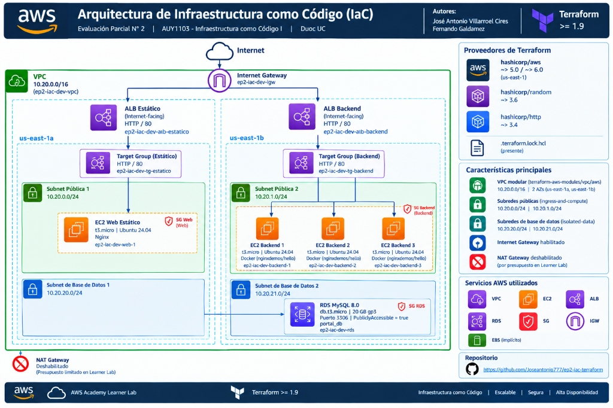

### Componentes Clave:
1. **Red (VPC Pública/Privada):** Módulo verificado del registro público `terraform-aws-modules/vpc/aws` versión `~> 5.0`.
   - 2 Zonas de disponibilidad (`us-east-1a`, `us-east-1b`).
   - Subredes públicas para balanceadores y cómputo (`10.20.0.0/24` y `10.20.1.0/24`).
   - Subredes de base de datos aisladas (`10.20.20.0/24` y `10.20.21.0/24`) con `create_database_subnet_group = true`.
   - Criterio de costo: `enable_nat_gateway = false` (evita costos innecesarios en Learner Lab).
2. **Balanceadores de Carga (ALB):** 
   - ALB 1: Balanceador de capa 7 para el Sitio Web Estático (HTTP:80).
   - ALB 2: Balanceador de capa 7 para el clúster de microservicios Docker (HTTP:80).
   - Health checks automáticos sobre la ruta `/`.
3. **Módulo Local Reutilizable (`./modules/servidor`):**
   - Instancias EC2 Ubuntu 24.04 LTS (Canonical gp3).
   - Security Groups con mínima exposición (tráfico HTTP:80 permitido **únicamente** desde el Security Group del ALB correspondiente).
   - Registro automatizado de targets en el Target Group del ALB.
   - Reutilizado para el Sitio Estático (`cantidad = 1`) y para los Backends (`cantidad = var.backend_count`).
4. **Base de Datos Persistente:**
   - AWS RDS MySQL 8.0 (`db.t3.micro`, gp3 de 20 GiB).
   - Contraseña robusta generada declarativamente mediante el provider `hashicorp/random` (`random_password`).
   - Security Group restrictivo que permite acceso únicamente desde los backends Docker y la IP pública del administrador (`data.http.mi_ip`).

---

## 2. Decisiones de Diseño y Variantes del Diagrama

### A. Elección de Iteración: `count` vs `for_each` (Rúbrica IE 3.2.1)
- **Instancias EC2 Backend (`count`):**  
  Se utilizó `count = var.backend_count` debido a que las instancias de backend son **homogéneas, intercambiables y efímeras**. No poseen identidad persistente individual; si se reduce o amplía la escala (por ejemplo de 3 a 4 instancias en producción), Terraform simplemente agrega o destruye en el extremo de la lista sin causar drift de direccionamiento.
- **Balanceadores y Reglas (`for_each` sobre map y set):**  
  Se utilizó `for_each` para los Application Load Balancers (`local.albs`) y los bloques `dynamic "ingress"` debido a que cada balanceador y puerto posee **identidad propia e independiente**. Esto garantiza que si se modifica una regla o un balanceador, no se afecte el ciclo de vida del otro.

### B. Variantes Justificadas del Diagrama (Learner Lab Guardrails)
- **Capa CDN / CloudFront y S3 Object Lock:**  
  En entornos de AWS Academy Learner Lab, la política de control de servicios organizacional (**SCP**) bloquea de manera explícita las acciones `cloudfront:*` (CloudFront no está autorizado en cuentas educativas de laboratorio) y `s3:GetBucketObjectLockConfiguration`.  
  *Justificación técnica:* Siguiendo las directrices de la guía de evaluación (pág. 4: *"Si el estudiante decide implementar una variante... debe justificarla en el README"*), el contenido web y los microservicios se sirven de forma altamente disponible directamente a través del Application Load Balancer redundante en múltiples AZ.

---

## 3. Estructura del Proyecto

```
ep2-iac-terraform/
├── terraform.tf          # Versiones requeridas (Terraform >= 1.9, AWS ~> 6.0/5.0, random, http)
├── .terraform.lock.hcl   # Bloqueo criptográfico de dependencias
├── main.tf               # Orquestación de infraestructura (VPC, ALBs, RDS, módulos)
├── variables.tf          # Variables tipadas, descripciones y validaciones
├── locals.tf             # Valores locales, cálculo de CIDRs y tags comunes con merge()
├── data.tf               # Data sources (AMI Ubuntu 24.04, AZs, IP pública actual)
├── outputs.tf            # Puntos de enlace, DNS de balanceadores y outputs sensibles
├── dev.tfvars            # Configuración entorno Desarrollo (t3.micro, 3 backends)
├── prod.tfvars           # Configuración entorno Producción (t3.small, 4 backends)
├── .gitignore            # Exclusión de estado y credenciales
├── README.md             # Este documento con diagrama y evidencias
├── Informe_Evaluacion_IaC_Villarroel_Galdamez_Ev2.docx # Informe oficial Word
├── Informe_Evaluacion_IaC_Villarroel_Galdamez_Ev2.pdf  # Informe oficial PDF
├── assets/
│   ├── diagrama_arquitectura.jpg # Diagrama oficial de arquitectura en AWS
│   └── duoc.png
├── scripts/
│   ├── web.sh.tftpl      # Provisionamiento de Nginx con datos del estudiante
│   └── backend.sh        # Provisionamiento de Docker y contenedor web
├── modules/
│   └── servidor/         # Módulo local reutilizable
│       ├── main.tf       # EC2 + Security Group + Target Group Attachment
│       ├── variables.tf  # Parámetros tipados de entrada
│       └── outputs.tf    # SG ID e Instance IDs
├── salidas/              # Evidencias en texto plano
│   ├── state_list.txt
│   ├── output.txt
│   └── show.txt
└── evidencias/           # 11 Capturas secuenciales de validación
    ├── 01_terraform_init.png
    ├── 02_terraform_validate.png
    ├── 03_terraform_plan_dev.png
    ├── 04_terraform_apply_outputs.png
    ├── 05_validacion_web_estatico.png
    ├── 06_validacion_backends_docker.png
    ├── 07_validacion_dbeaver_conexion.png
    ├── 08_validacion_dbeaver_query_alumnos.png
    ├── 09_idempotencia_no_changes.png
    ├── 10_plan_produccion_multientorno.png
    └── 11_destroy_complete.png
```

---

## 4. Instrucciones de Ejecución por Entorno

### Configuración previa de credenciales (Learner Lab):
```bash
aws configure set aws_access_key_id <TU_ACCESS_KEY>
aws configure set aws_secret_access_key <TU_SECRET_KEY>
aws configure set aws_session_token <TU_SESSION_TOKEN>
aws configure set region us-east-1
```

### Entorno de Desarrollo (Dev):
```bash
# 1. Inicializar
terraform init

# 2. Validar sintaxis
terraform validate

# 3. Planificar y aplicar en desarrollo
terraform plan -var-file=dev.tfvars -out=plan.tfplan
terraform apply plan.tfplan

# 4. Obtener contraseña de RDS
terraform output -raw rds_password
```

### Entorno de Producción (Prod):
```bash
# Simular y verificar plan de producción sin alterar desarrollo
terraform plan -var-file=prod.tfvars
```

### Limpieza y Destrucción:
```bash
terraform destroy -var-file=dev.tfvars -auto-approve
```

---

## 5. Evidencias Visuales del Despliegue y Validación

### Etapa 1: Ambiente de Trabajo y Validación
#### 1. `terraform init` exitoso (Descarga de providers y módulos)
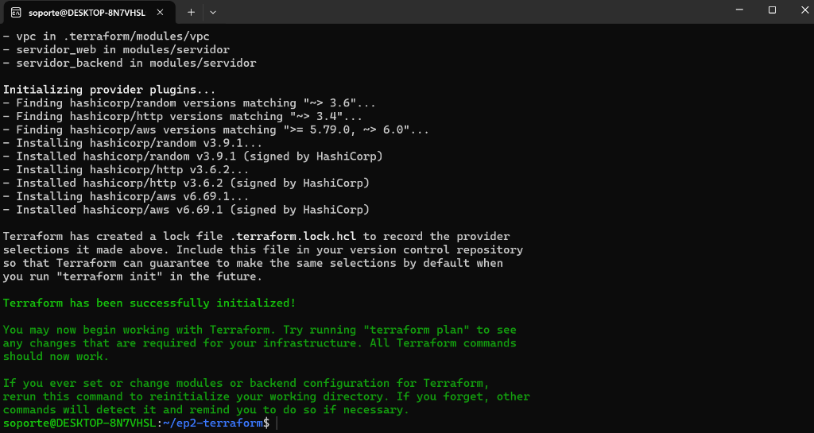

#### 2. `terraform validate` y `terraform fmt`
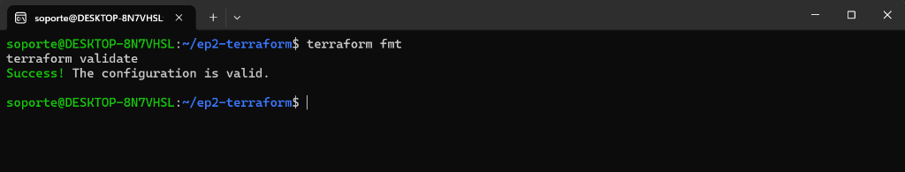

---

### Etapa 2: Implementación y Planificación
#### 3. `terraform plan` (Entorno Dev)
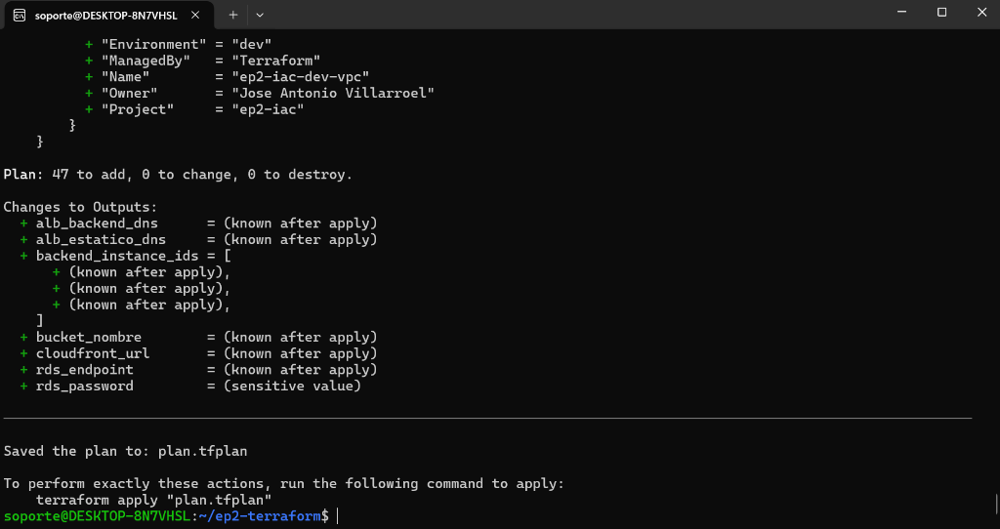

#### 4. `terraform apply` completado con Outputs
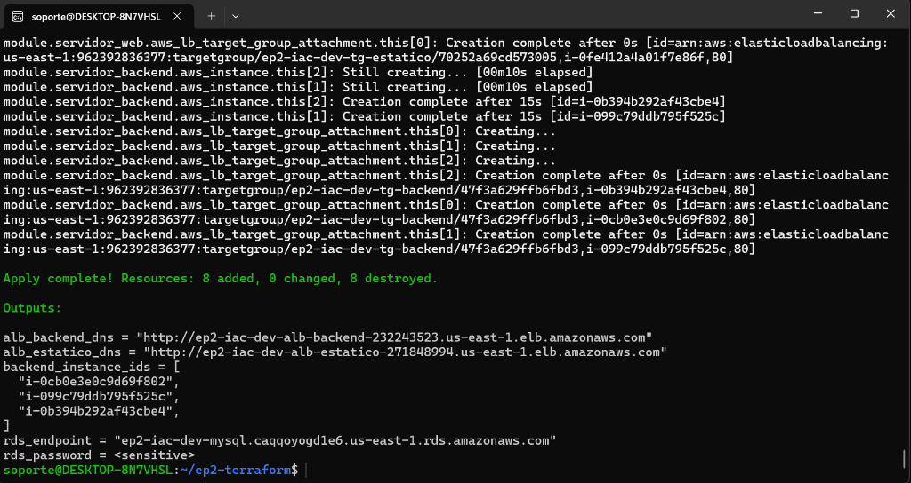

---

### Etapa 3: Validación Funcional de Servicios
#### 5. Sitio Web Estático en el Navegador (ALB Estático)
Página servida por Nginx mostrando a los integrantes del proyecto tras el balanceador:
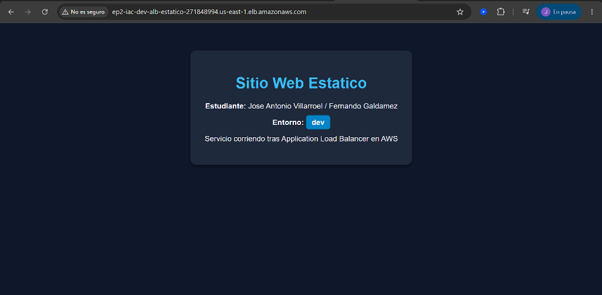

#### 6. Clúster de Microservicios Docker en el Navegador (ALB Backend)
Contenedor `nginxdemos/hello` respondiendo balanceado con su IP y Server Name:
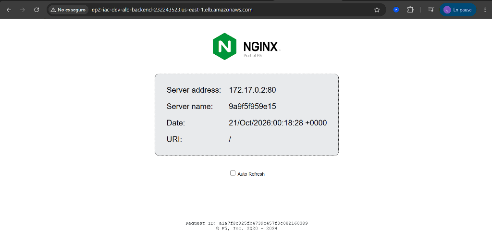

#### 7. Parámetros de Conexión en DBeaver hacia RDS MySQL
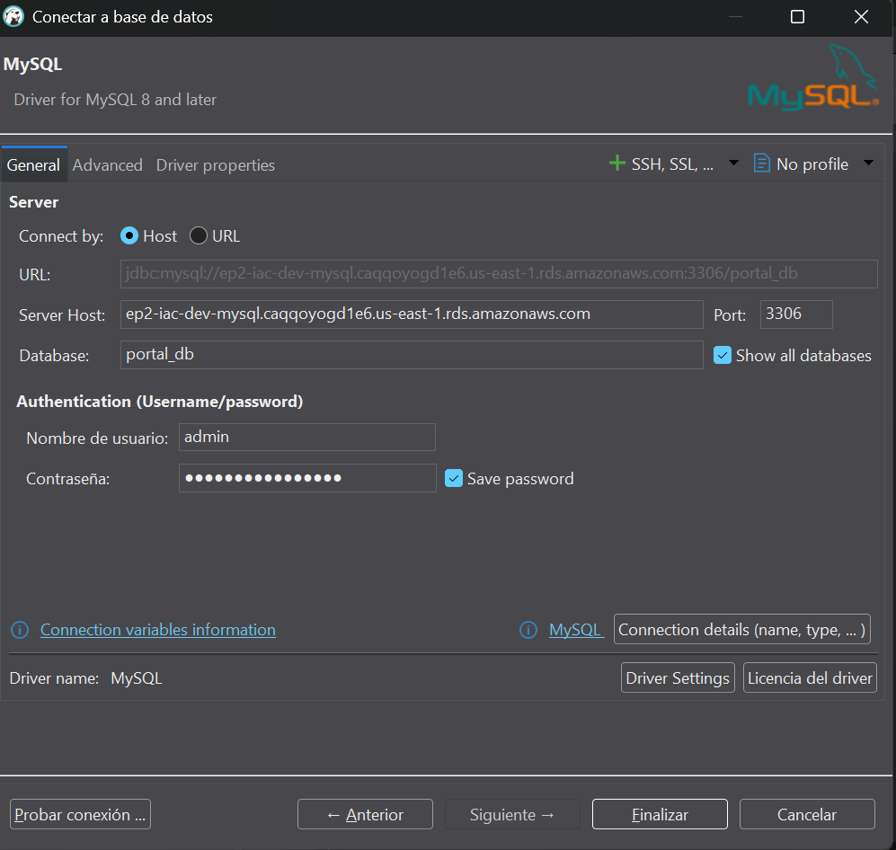

#### 8. Consulta SQL en DBeaver (`SELECT * FROM alumnos`)
Registros de los integrantes insertados y consultados en la base de datos persistente:
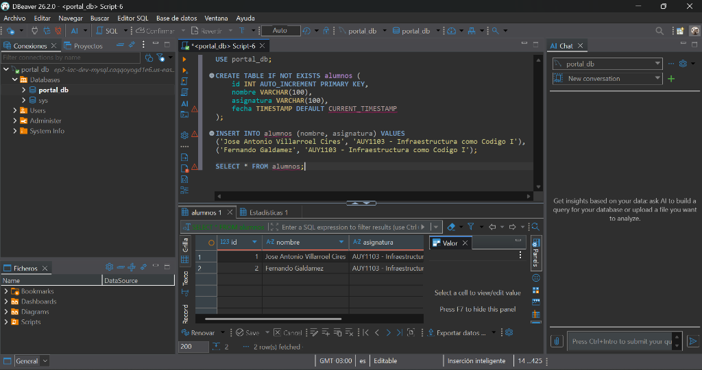

---

### Etapa 4: Depuración, Idempotencia y Multi-entorno
#### 9. Demostración de Idempotencia (`No changes`)
Comprobación de que el estado en AWS coincide exactamente con el código:
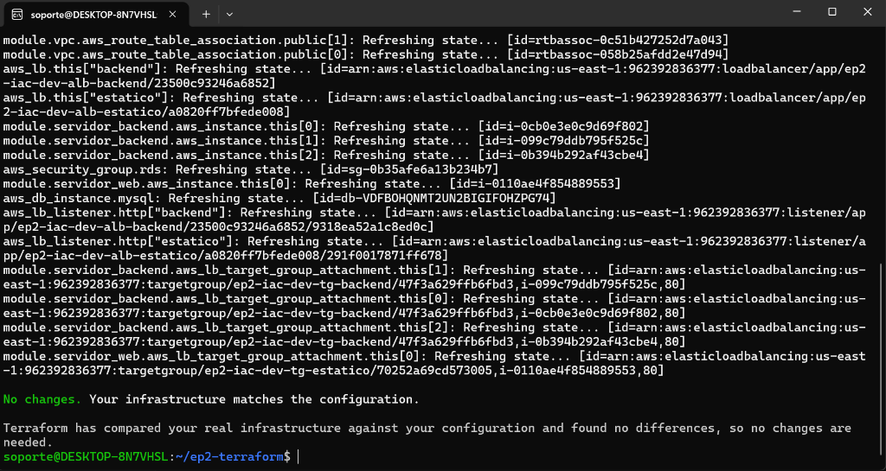

#### 10. Plan del Entorno de Producción (`prod.tfvars`)
Demostración de escalabilidad y tipado sin alterar desarrollo (4 backends, `t3.small`):
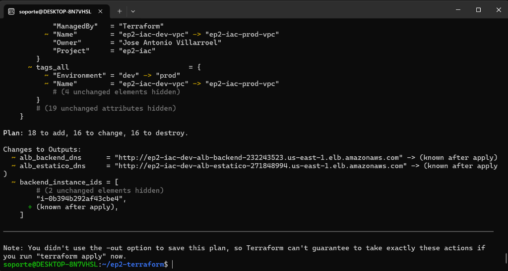

---

### Etapa 5: Cierre y Destrucción Controlada
#### 11. `terraform destroy` completado (`Destroy complete! Resources: 39 destroyed`)
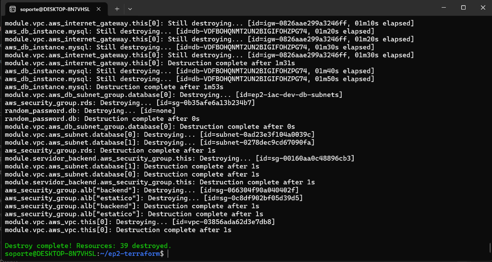
