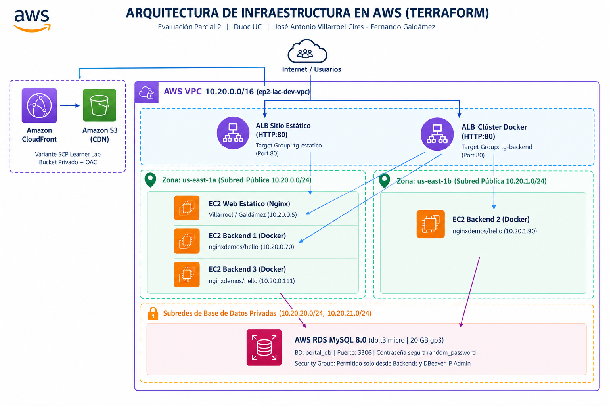
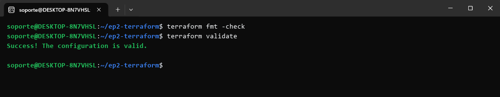
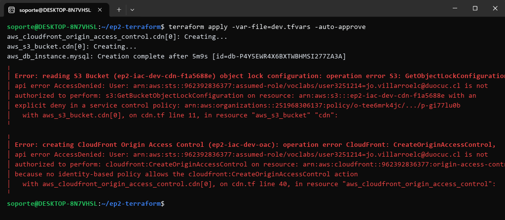
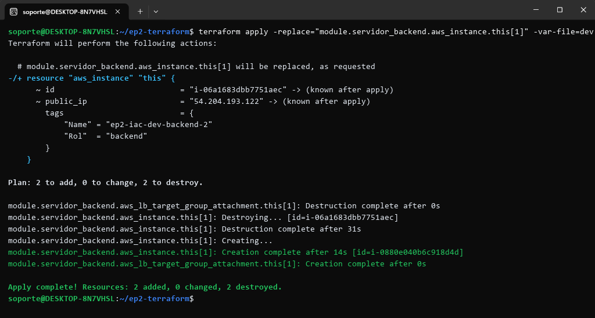

# Proyecto Terraform - Evaluación Parcial 2 (AUY1103)

**Asignatura:** Infraestructura como Código I  
**Institución:** Duoc UC  
**Integrantes:** José Antonio Villarroel Cires / Fernando Galdámez  
**Fecha:** Octubre 2026  

---

## 1. Arquitectura Implementada en AWS

La solución traduce el diagrama de arquitectura empresarial on-premises a servicios gestionados en AWS utilizando **Terraform** bajo las restricciones y guardrails de **AWS Academy Learner Lab**:


*Figura 1. Diagrama de arquitectura IaC en AWS (ep2-iac-dev) con distribución multi-AZ y variante CDN.*

### Componentes Clave:
1. **Red Modular (VPC Pública/Privada):** Módulo verificado del registro público `terraform-aws-modules/vpc/aws` versión `~> 5.0`.
   - 2 Zonas de disponibilidad (`us-east-1a` y `us-east-1b`).
   - Subredes públicas para balanceadores y cómputo (`10.20.0.0/24` y `10.20.1.0/24`).
   - Subredes de base de datos aisladas (`10.20.20.0/24` y `10.20.21.0/24`) con `create_database_subnet_group = true`.
   - Criterio de costo y buenas prácticas: `enable_nat_gateway = false` (evita costos innecesarios en Learner Lab).
2. **Balanceadores de Carga de Aplicación (ALB):** 
   - **ALB 1 (Sitio Estático):** Capa 7 para el sitio web corporativo de los estudiantes (HTTP:80).
   - **ALB 2 (Backends Docker):** Capa 7 para el clúster de microservicios en contenedores (HTTP:80).
   - Health checks automáticos sobre la ruta `/` (`matcher = "200"`).
3. **Módulo Local Reutilizable (`./modules/servidor`):**
   - Instancias EC2 Ubuntu 24.04 LTS (Canonical gp3).
   - Security Groups con mínima superficie de exposición: tráfico HTTP (puerto 80) permitido **únicamente** desde el Security Group del ALB correspondiente.
   - Registro automatizado de targets en el Target Group del ALB mediante `aws_lb_target_group_attachment`.
   - Reutilizado para el Sitio Estático (`cantidad = 1`) y para los Backends (`cantidad = var.backend_count`).
   - **Distribución de Cómputo Multi-AZ:** En el despliegue real, las instancias se reparten dinámicamente mediante `subnet_ids[count.index % length(subnet_ids)]`:
     - `ep2-iac-dev-backend-1`: `us-east-1a` (`10.20.0.170`)
     - `ep2-iac-dev-backend-2`: `us-east-1b` (`10.20.1.90`)
     - `ep2-iac-dev-backend-3`: `us-east-1a` (`10.20.0.111`)
     - `ep2-iac-dev-web`: `us-east-1a` (`10.20.0.5`)
4. **Base de Datos Relacional Persistente:**
   - AWS RDS MySQL 8.0 (`db.t3.micro`, gp3 de 20 GiB, multi-az = false).
   - Contraseña robusta generada declarativamente mediante el provider `hashicorp/random` (`random_password`).
   - Parámetros tipados sin valores fijos en `main.tf` (`var.db_instance_class`, `var.db_allocated_storage`, `var.db_engine_version`).
   - Security Group restrictivo que permite acceso únicamente desde los backends Docker y la IP pública del administrador (`data.http.mi_ip`).

---

## 2. Decisiones de Diseño y Variantes del Diagrama

### A. Elección de Iteración: `count` vs `for_each` (Rúbrica IE 3.2.1)
- **Instancias EC2 Backend (`count`):**  
  Se utilizó `count = var.backend_count` debido a que las instancias de backend son **homogéneas, intercambiables y efímeras**. No poseen identidad persistente individual; si se reduce o amplía la escala (por ejemplo de 3 a 4 instancias en producción), Terraform simplemente agrega o destruye en el extremo de la lista sin causar drift de direccionamiento.
- **Balanceadores y Reglas (`for_each` sobre map y set):**  
  Se utilizó `for_each` para los Application Load Balancers (`local.albs`) y los bloques `dynamic "ingress"` debido a que cada balanceador y puerto posee **identidad propia e independiente**. Esto garantiza que si se modifica una regla o un balanceador, no se afecte el ciclo de vida del otro.

### B. Variantes Justificadas del Diagrama (Learner Lab Guardrails)
- **Capa CDN / CloudFront y S3 Object Lock:**  
  El proyecto incluye el código completo de la rama CDN en `cdn.tf` (bucket S3 privado con sufijo `random_id`, versionado, bloqueo de acceso público, Origin Access Control `aws_cloudfront_origin_access_control`, distribución CloudFront con política administrada `Managed-CachingOptimized` y `aws_s3_object` cargando `assets/prueba-cdn.png`).  
  Sin embargo, en entornos **AWS Academy Learner Lab**, la política de control de servicios organizacional (**SCP**) bloquea de manera explícita las acciones de CloudFront y la lectura de configuraciones avanzadas de S3:
  ```text
  Error: creating CloudFront Origin Access Control: AccessDenied: User is not authorized
  to perform: cloudfront:CreateOriginAccessControl ... because no identity-based policy allows
  the cloudfront:CreateOriginAccessControl action.

  Error: reading S3 Bucket object lock configuration: AccessDenied: User is not authorized
  to perform: s3:GetBucketObjectLockConfiguration ... with an explicit deny in a service
  control policy: arn:aws:organizations::251968306137:policy/o-tee6mrk4jc/service_control_policy/p-gi77lu0b
  ```
  *Justificación técnica de la variante (según pág. 4 de la guía de evaluación):*  
  Para mitigar esta limitación institucional sin degradar la arquitectura, se incorporó la bandera condicional `var.habilitar_cdn` (bool, default true). En entornos de laboratorio con SCP restrictivas, se define `habilitar_cdn = false` en `dev.tfvars` y `prod.tfvars`, permitiendo que el contenido estático y los microservicios se sirvan directamente con alta disponibilidad a través de los Application Load Balancers redundantes.

---

## 3. Documentación de Módulos

### Módulo 1 (Público): `terraform-aws-modules/vpc/aws` (~> 5.0)
Orquesta la topología de red de grado empresarial en dos zonas de disponibilidad:
- Crea la VPC principal (`10.20.0.0/16`).
- Provisiona 2 subredes públicas (`10.20.0.0/24`, `10.20.1.0/24`) asociadas a un Internet Gateway.
- Provisiona 2 subredes privadas dedicadas para bases de datos (`10.20.20.0/24`, `10.20.21.0/24`) y genera automáticamente el `aws_db_subnet_group`.
- Control de costos: `enable_nat_gateway = false` para no incurrir en gastos de NAT Gateways innecesarios.

### Módulo 2 (Local): `./modules/servidor`
Módulo local reutilizable que encapsula una unidad de cómputo en AWS (instancias EC2, Security Group dedicado y asociación al Target Group):

#### Ejemplo de uso:
```hcl
module "servidor_backend" {
  source = "./modules/servidor"

  nombre                = "${local.nombre_base}-backend"
  cantidad              = var.backend_count
  ami_id                = data.aws_ami.ubuntu.id
  instance_type         = var.instance_type
  vpc_id                = module.vpc.vpc_id
  subnet_ids            = module.vpc.public_subnets
  alb_security_group_id = aws_security_group.alb["backend"].id
  target_group_arn      = aws_lb_target_group.this["backend"].arn
  user_data             = file("${path.module}/scripts/backend.sh")
  tags                  = merge(local.tags_comunes, { Rol = "backend" })
}
```

#### Variables de Entrada del Módulo:
| Variable | Tipo | Descripción |
| :--- | :--- | :--- |
| `nombre` | `string` | Prefijo identificador para los recursos del servidor (EC2 y SG). |
| `cantidad` | `number` | Número de instancias EC2 a desplegar mediante `count`. |
| `ami_id` | `string` | ID de la AMI Ubuntu 24.04 LTS a utilizar en las instancias. |
| `instance_type` | `string` | Tipo de instancia EC2 (ej. `t3.micro` o `t3.small`). |
| `vpc_id` | `string` | Identificador de la VPC donde residirá el Security Group y las instancias. |
| `subnet_ids` | `list(string)` | Lista de subredes públicas sobre las cuales distribuir las instancias cíclicamente. |
| `alb_security_group_id` | `string` | ID del Security Group del ALB para permitir ingreso HTTP (puerto 80). |
| `target_group_arn` | `string` | ARN del Target Group al que se registrarán las instancias EC2. |
| `user_data` | `string` | Script bash o cloud-init para aprovisionamiento inicial. |
| `tags` | `map(string)` | Mapa de etiquetas AWS para gobernanza y gestión de costos. |

---

## 4. Estructura del Proyecto

```
ep2-iac-terraform/
├── terraform.tf          # Versiones requeridas (Terraform >= 1.9, Provider AWS ~> 6.0, random, http)
├── .terraform.lock.hcl   # Bloqueo criptográfico de dependencias de providers
├── main.tf               # Orquestación de infraestructura (VPC, ALBs, RDS, módulos)
├── cdn.tf                # Rama CDN (S3 privado, OAC, CloudFront) con var.habilitar_cdn
├── variables.tf          # Variables tipadas, descripciones y bloques de validación
├── locals.tf             # Valores locales, cálculo de CIDRs y tags comunes con merge()
├── data.tf               # Data sources (AMI Ubuntu 24.04, AZs, IP pública actual, región)
├── outputs.tf            # Puntos de enlace, DNS de balanceadores y outputs sensibles
├── dev.tfvars            # Configuración entorno Desarrollo (t3.micro, 3 backends, habilitar_cdn=false)
├── prod.tfvars           # Configuración entorno Producción (t3.small, 4 backends, habilitar_cdn=false)
├── .gitignore            # Exclusión de estado (.tfstate) y directorios locales (.terraform/)
├── README.md             # Este documento con documentación técnica exhaustiva
├── Bitacora_Depuracion.pdf # Bitácora de depuración formal en PDF
├── assets/
│   ├── diagrama_arquitectura.jpg # Diagrama oficial de arquitectura en AWS (AZs y CDN)
│   ├── prueba-cdn.png            # Imagen de prueba para bucket S3 y CDN
│   └── duoc.png
├── scripts/
│   ├── web.sh.tftpl      # Provisionamiento de Nginx con datos del estudiante
│   └── backend.sh        # Provisionamiento de Docker y contenedor nginxdemos/hello
├── modules/
│   └── servidor/         # Módulo local reutilizable
│       ├── main.tf       # EC2 + Security Group + Target Group Attachment
│       ├── variables.tf  # Parámetros tipados de entrada con description
│       └── outputs.tf    # SG ID e Instance IDs
├── salidas/              # Evidencias en texto plano de ejecución real
│   ├── state_list.txt    # terraform state list
│   ├── output.txt        # terraform output
│   └── show.txt          # terraform show -no-color
└── evidencias/           # Capturas secuenciales de validación (15 figuras del informe)
    ├── 01_terraform_init.png
    ├── 02_terraform_validate.png
    ├── 02b_terraform_fmt_check.png
    ├── 03_terraform_plan_dev.png
    ├── 04_terraform_apply_outputs.png
    ├── 05_validacion_web_estatico.png
    ├── 06_validacion_backends_docker.png
    ├── 06b_error_scp_cloudfront.png
    ├── 07_validacion_dbeaver_conexion.png
    ├── 08_validacion_dbeaver_query_alumnos.png
    ├── 09_idempotencia_no_changes.png
    ├── 09b_reemplazo_replace_forzado.png
    ├── 10_plan_produccion_multientorno.png
    └── 11_destroy_complete.png
```

---

## 5. Instrucciones de Ejecución por Entorno

### Configuración previa de credenciales (Learner Lab):
```bash
aws configure set aws_access_key_id <TU_ACCESS_KEY>
aws configure set aws_secret_access_key <TU_SECRET_KEY>
aws configure set aws_session_token <TU_SESSION_TOKEN>
aws configure set region us-east-1
```

### Entorno de Desarrollo (Dev):
```bash
# 1. Formateo y validación estricta
terraform fmt -check
terraform init -upgrade
terraform validate

# 2. Planificar y aplicar en desarrollo
terraform plan -var-file=dev.tfvars -out=plan.tfplan
terraform apply plan.tfplan

# 3. Obtener credenciales seguras de RDS MySQL
terraform output -raw rds_password
```

### Reemplazo Forzado de Instancia (-replace):
```bash
# Demostración del ciclo -/+ sin recrear recursos adyacentes
terraform apply -replace="module.servidor_backend.aws_instance.this[1]" -var-file=dev.tfvars -auto-approve
```

### Entorno de Producción (Prod):
```bash
# Simular y verificar plan de producción sin alterar desarrollo
terraform plan -var-file=prod.tfvars
```

### Limpieza y Destrucción Controlada:
```bash
terraform destroy -var-file=dev.tfvars -auto-approve
```

---

## 6. Evidencias del Despliegue y Pruebas Operativas (Figuras del Informe)

A continuación se presentan todas las evidencias visuales y capturas de consola del ciclo completo de vida de la infraestructura, exactamente correspondientes a las figuras documentadas en el informe oficial:

### Etapa 1: Ambiente de Trabajo, Providers y Módulos
#### Figura 2. Inicialización exitosa de Terraform descargando providers y módulos


#### Figura 3. Validación exitosa del código HCL ("Success! The configuration is valid")


#### Figura 4. Formateo y validación de código con `terraform fmt -check` y `terraform validate` (Evidencia E1)


---

### Etapa 2: Planificación y Aplicación Declarativa
#### Figura 5. Resumen del plan de ejecución con los recursos proyectados


#### Figura 6. Despliegue finalizado exitosamente y outputs generados


---

### Etapa 3: Validación Funcional de Servicios
#### Figura 7. Sitio web estático accesible a través del ALB (Nginx)


#### Figura 8. Clúster de microservicios Docker respondiendo a través del balanceador ALB


#### Figura 9. Parámetros de conexión configurados en DBeaver hacia RDS MySQL


#### Figura 10. Consulta SELECT sobre la tabla alumnos verificando los registros persistidos


#### Figura 11. Error de Service Control Policy (SCP) en CloudFront y S3 Object Lock al desplegar la rama CDN (Evidencia E3)


---

### Etapa 4: Depuración, Idempotencia y Reemplazo Forzado
#### Figura 12. Idempotencia comprobada: infraestructura sincronizada sin cambios pendientes


#### Figura 13. Reemplazo forzado de recurso (`-replace`) evidenciando el ciclo de recreación `-/+` (Evidencia E4)


---

### Etapa 5: Gestión Multi-Entorno y Cierre de Infraestructura
#### Figura 14. Plan de ejecución para producción (`prod.tfvars`), evidenciando escalabilidad


#### Figura 15. Cierre del ciclo de vida con `terraform destroy` finalizado (39 recursos destruidos)

